

  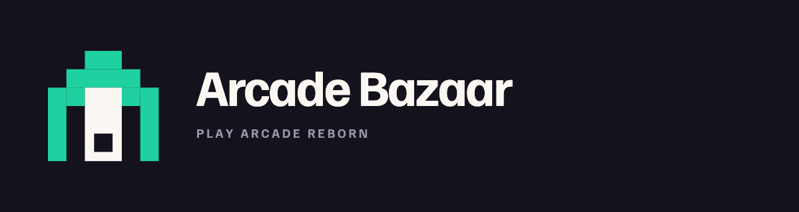

<h1 align="center">Arcade Bazaar · Ganymede</h1>

  <b>Colosseum Crypto World Fair Hackathon submission</b> 
  A modern online arcade where every game plays in a <b>Vintage</b> and a <b>Modern</b> view,
  coins are <b>x402</b> payments in USDC, and <b>Ganymede</b> is our own game engine.

  <a href="https://ab.goplausible.xyz/app/"><b>▶ Play it live: ab.goplausible.xyz</b></a>

  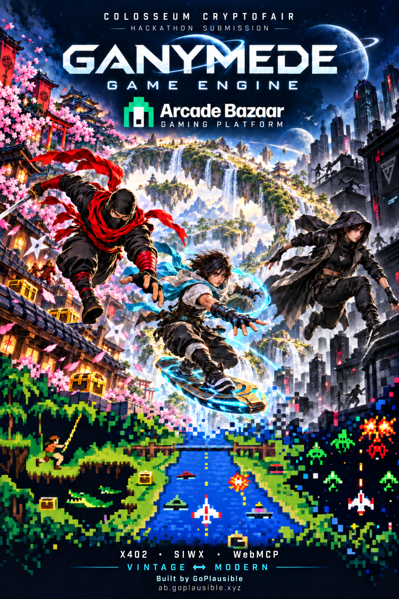

---

## Links

|                                  |                                             |
| -------------------------------- | ------------------------------------------- |
| **Live app**                     | https://ab.goplausible.xyz/app/             |
| **Arcade Bazaar** (the platform) | https://github.com/GoPlausible/arcadebazaar |
| **Ganymede** (the game engine)   | https://github.com/GoPlausible/Ganymede     |
| **Built by**                     | [GoPlausible](https://goplausible.com)      |

## Crypto World Fair Hackathon Videos

<table>
  <tr>
    <td align="center" width="60%">
      <a href="https://ab.goplausible.xyz/media/cryptofair-pitch.mp4">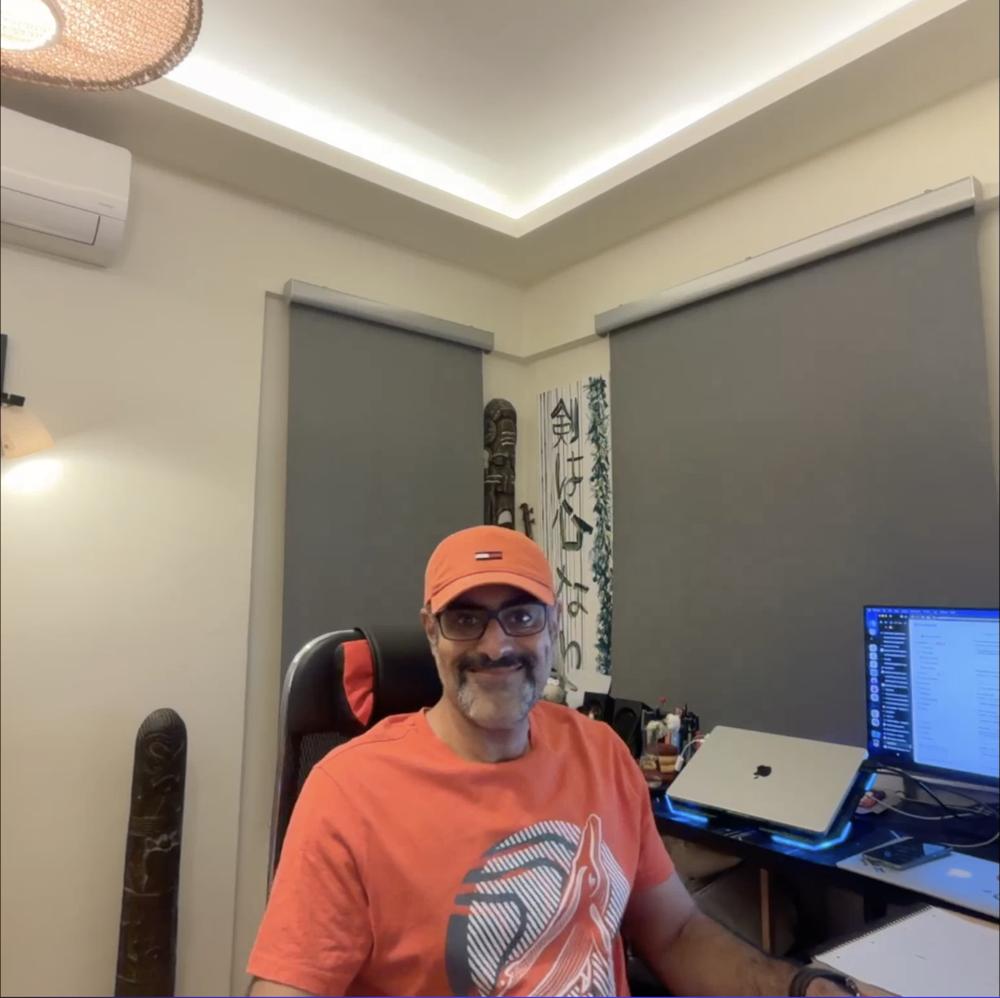</a> 
      <b><a href="https://ab.goplausible.xyz/media/cryptofair-pitch.mp4">▶ The pitch</a></b> · ~2 min
    </td>
    <td align="center" width="40%">
       
      <b><a href="https://ab.goplausible.xyz/media/cryptofair-demo.mp4">▶ The demo</a></b> · ~4 min
    </td>
  </tr>
</table>

---

## What it is

**Arcade Bazaar** is an arcade for the web, and it works like one: you play with coins. Its floor holds
eleven cabinets — six recreations of golden-age classics and five original games of our own — and every one
of them plays in two views at once:

- **Vintage** — the original's screen: its pixel grid, its palette, its pace.
- **Modern** — the same run rebuilt for today's screens, in WebGL2 and custom shaders.

Press **V** and the run carries straight across, mid-game: it is one game drawn twice, not two games. The
landing page shows it live — one run, both views, with a seam you can drag between them.

  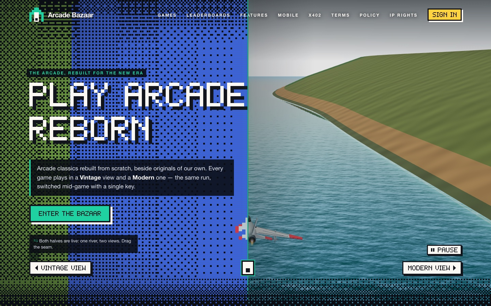

### Coins, the arcade way — paid with x402

- **Sign in with your email.** Your first sign-in puts a **50¢ coin on the house**: 50 plays.
- **Insert a coin** when your credit runs out: **10¢** (10 plays), **50¢** (50 plays) or **100¢** (100 plays),
  paid in **USDC** from your own wallet on **Solana**, **Base** or **Algorand**.
- **A play is one whole game** — every life, until game over. Credit is shared by every cabinet.
- **Nothing inside a game is for sale.** A coin buys plays, never an advantage.
- **High-score boards.** Every coin game keeps an all-time table of each player's best, under the name they
  choose — never their email.
- **River Raid can be played free.** A free play needs no coin and keeps no leaderboard. Played with credit,
  River Raid counts like any other coin game, with its scores on its own board.

The coin slot is **x402 v2**, the HTTP-native payment protocol: pressing play on a cabinet with no credit
opens the slot; the server answers the coin request with **`402 Payment Required`** and the coin's terms (one
way to pay per chain); the wallet signs; the same request goes again with the signature; the
**GoPlausible x402 facilitator** settles it on-chain, and only then is the credit added — once per
transaction. Network fees are paid by the facilitator, so a player only ever spends the coin. On Solana and
Algorand the payment carries the player's opaque account reference (a Solana memo, an Algorand note) — never
their email.

---

## The games

<table>
  <tr>
    <td width="33%">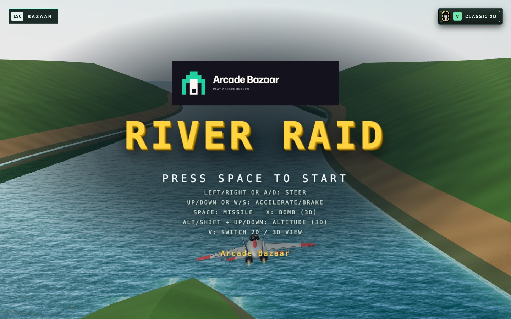 <b>River Raid</b> · free play Inspired by River Raid (Carol Shaw, Activision, 1982) <i>Fly the river. Bring down the bridges. Mind the fuel.</i></td>
    <td width="33%">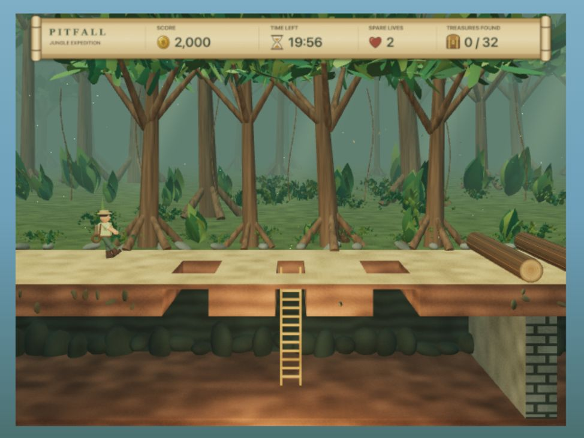 <b>Pitfall</b> Inspired by Pitfall! (David Crane, Activision, 1982) <i>Twenty minutes. Thirty-two treasures. Two hundred and fifty-five screens of jungle.</i></td>
    <td width="33%">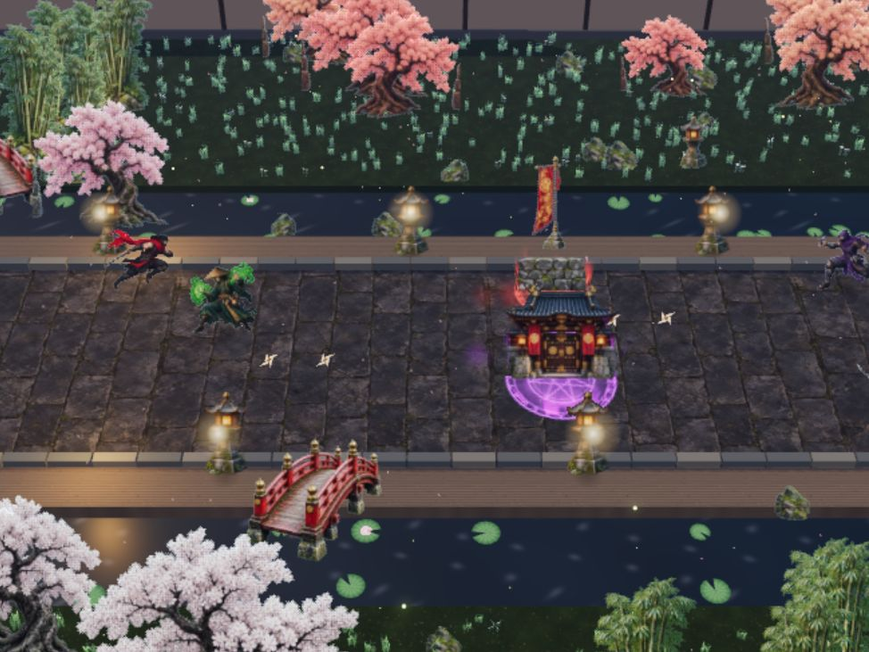 <b>Arc Ninja</b> · original Designed by @emg110 · built by GoPlausible <i>Four lanes. A thousand falling petals. One way through the Shogun’s garden.</i></td>
  </tr>
  <tr>
    <td>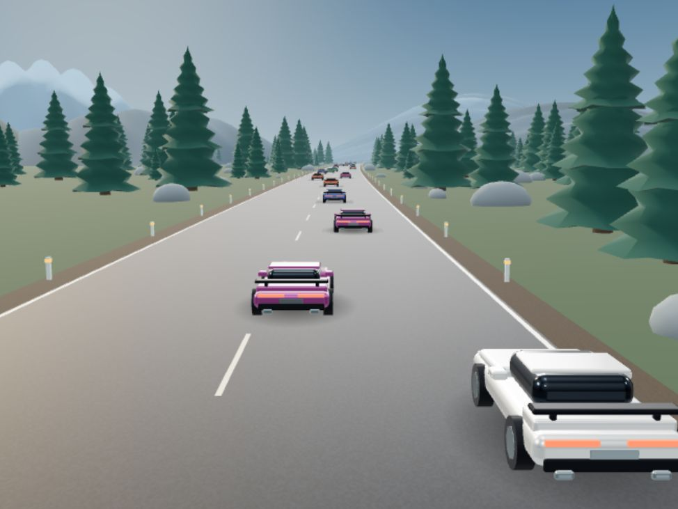 <b>Enduro</b> Inspired by Enduro (Larry Miller, Activision, 1983) <i>Chase the horizon. Two hundred cars before dawn. Then another day begins.</i></td>
    <td>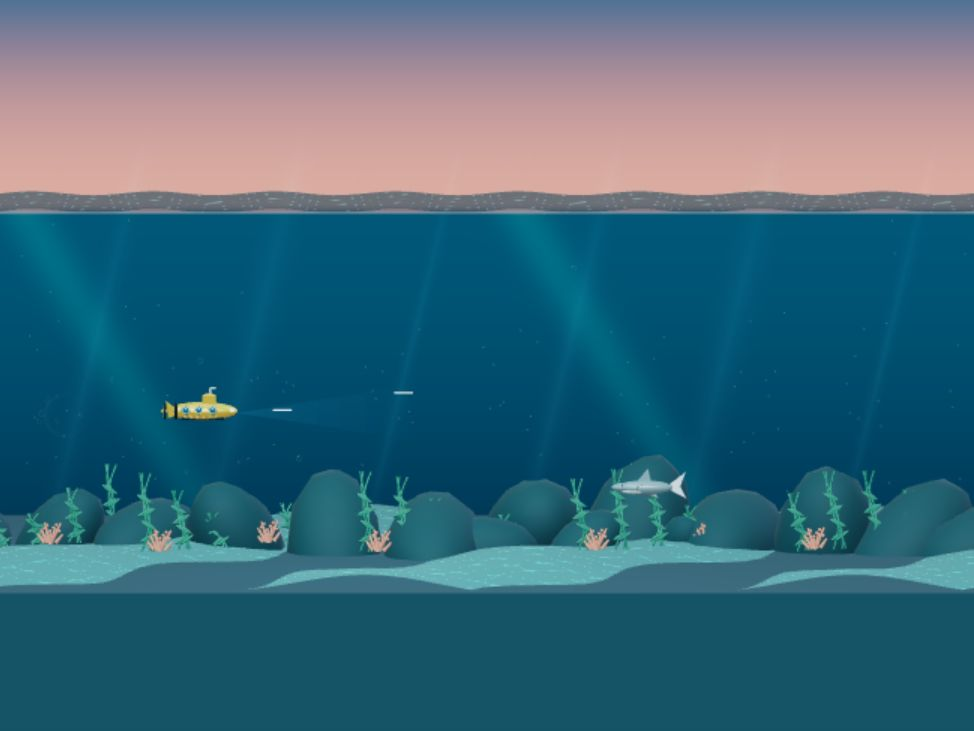 <b>Seaquest</b> Inspired by Seaquest (Steve Cartwright, Activision, 1983) <i>Six divers. One tank of oxygen. Bring them all back to the light.</i></td>
    <td>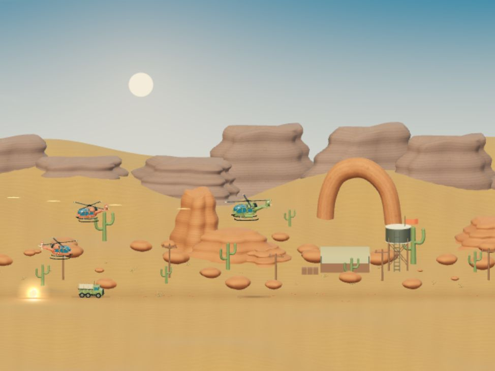 <b>Chopper Command</b> Inspired by Chopper Command (Bob Whitehead, Activision, 1982) <i>One helicopter. Twelve trucks. Keep the desert sky clear.</i></td>
  </tr>
  <tr>
    <td>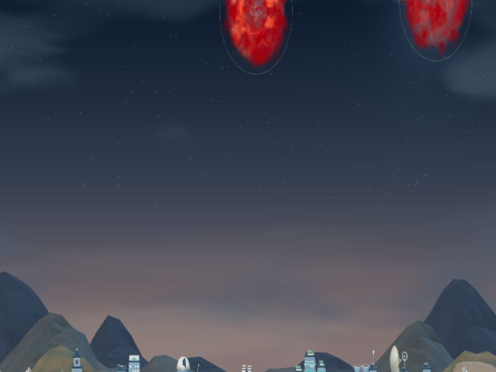 <b>Missile Command</b> Inspired by Missile Command (Dave Theurer, Atari, 1980) <i>Six cities. Three batteries. Hold the line.</i></td>
    <td>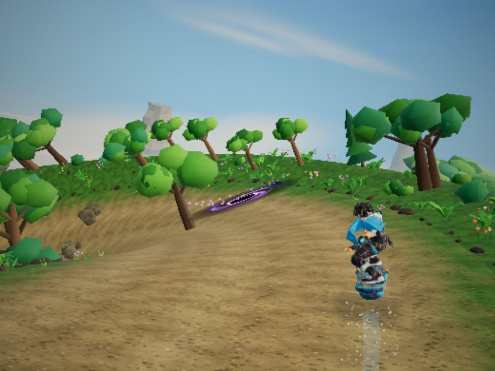 <b>Mobius</b> · original Designed by @emg110 · built by GoPlausible <i>A world with only one side. Ride it, rescue its surfers, find your flow.</i></td>
    <td>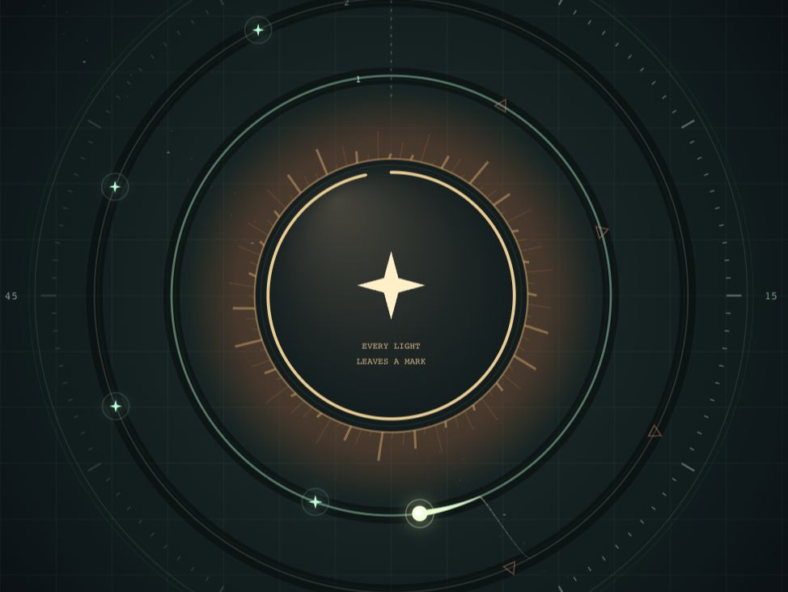 <b>Afterglow</b> · original Designed by @emg110 · built by GoPlausible <i>What you collect comes back for you.</i></td>
  </tr>
  <tr>
    <td>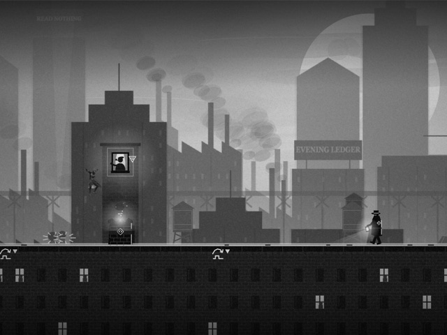 <b>Runner Noire</b> · original Designed by @emg110 · built by GoPlausible <i>The city never wakes. You never stop.</i></td>
    <td>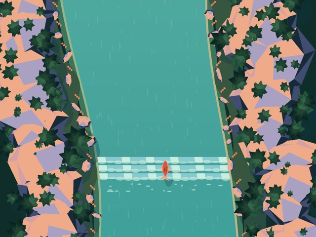 <b>The Journey</b> · original Designed by @emg110 · built by GoPlausible <i>Every river leads home.</i></td>
    <td></td>
  </tr>
</table>

Every game has its own loading screen in its own look, and a touch gamepad on phones (one thumb on a floating
stick, the other on the buttons, either hand); every coin game keeps its high-score board in its own look,
too. Several gain a **new touch** on purpose — River Raid altitude and bombs, Pitfall a whip, Chopper Command
dawn to night, and in the originals, Afterglow's past that becomes the level and Runner Noire's way up.

### Posters

<table>
  <tr>
    <td width="30%">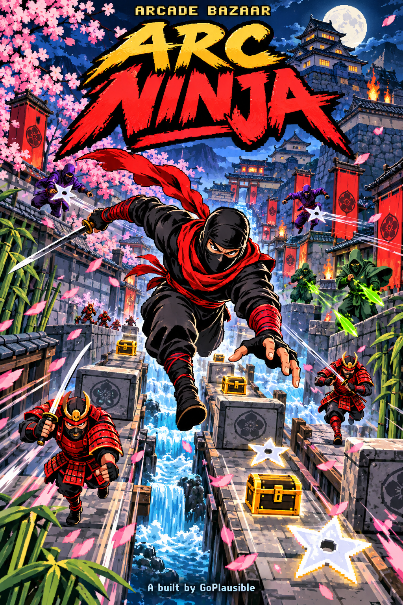 Arc Ninja</td>
    <td width="30%">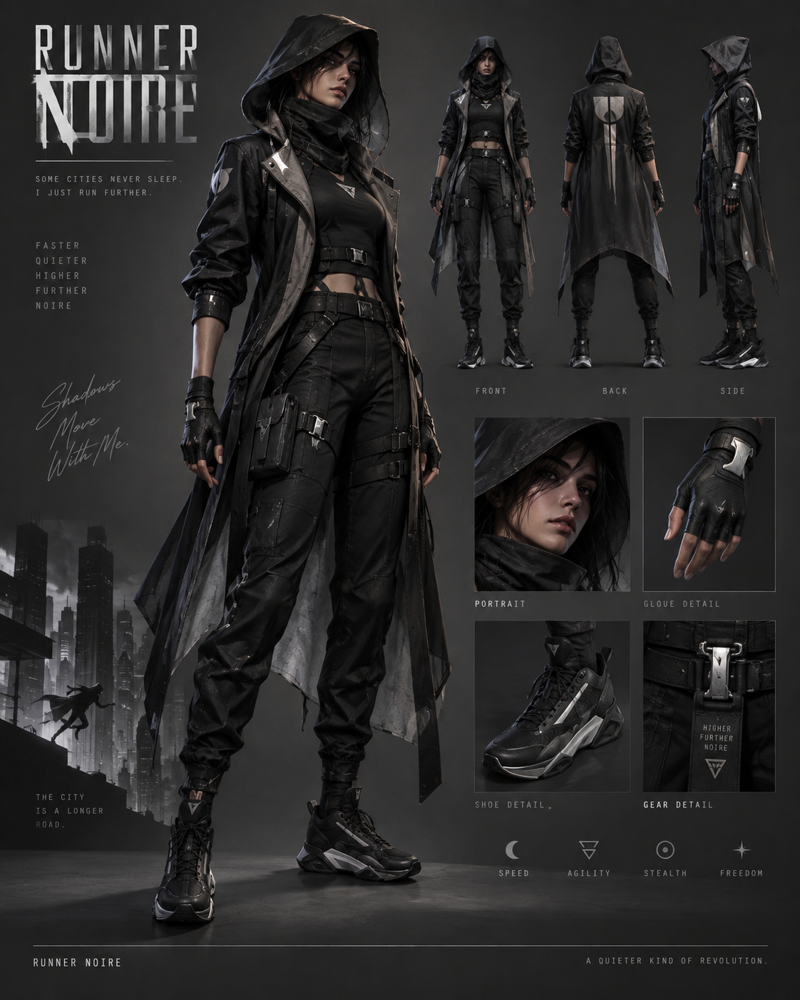 Runner Noire</td>
    <td width="30%">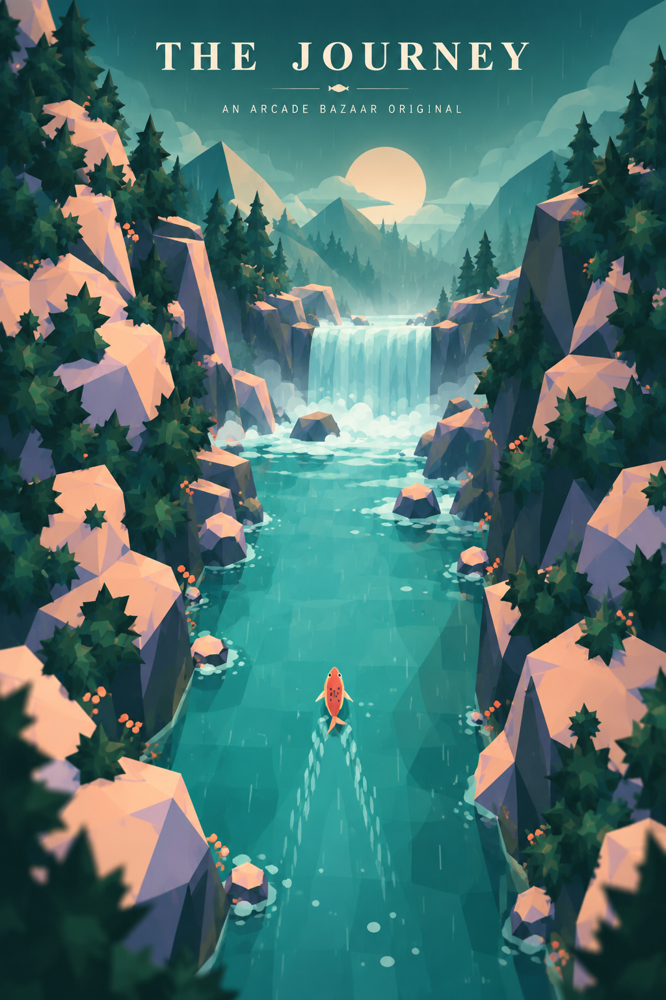 The Journey</td>
  </tr>

</table>
<table>
  <tr>
    <td width="100%">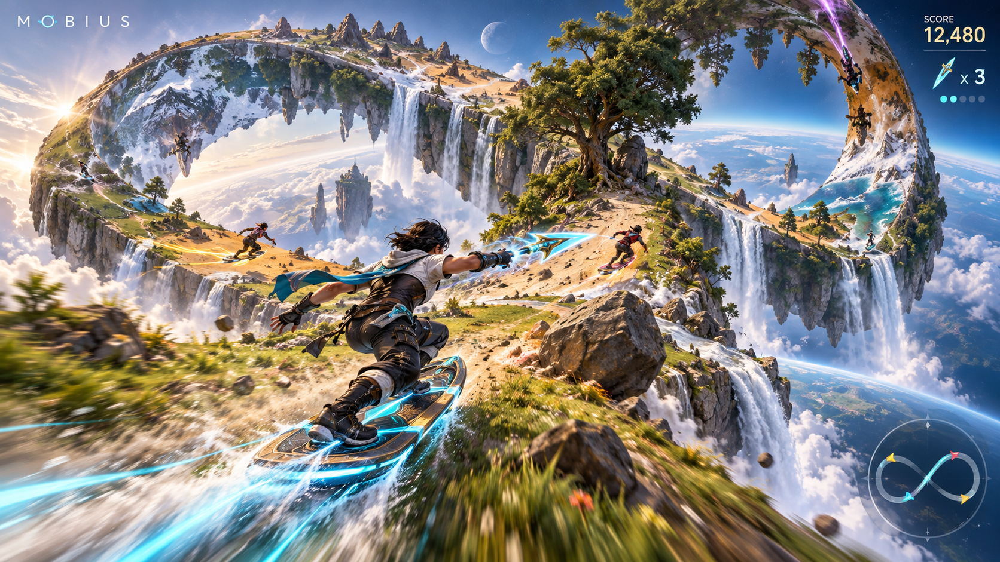 Mobius</td>
  </tr>
</table>
---

## How it is built: three parts

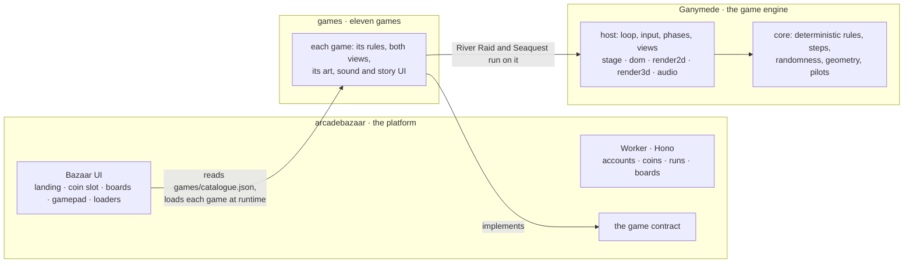

- **Arcade Bazaar** ([arcadebazaar](https://github.com/GoPlausible/arcadebazaar)) is the platform, and it holds
  **no game of its own**. It reads a **catalogue** of games when the page opens and loads each one — built on
  its own, from its own folder — behind **one small contract**: what a game provides (its manifest, its
  loading screen, its preview, its board, its loader) and what the platform gives it (the coin slot's
  `play()` and `gameOver()`, the view, the gamepad). The Worker reads its list of games from the same
  catalogue, so the floor and the server can never disagree.
- **The games** ([games](https://github.com/GoPlausible/games)) are eleven folders, each a whole game: its
  rules, its two views, its art, its sound and its story UI. A game fetches its engine, both views, its sound
  and its art behind its own loading screen only when you press play, so the landing page stays light.
- **Ganymede** ([Ganymede](https://github.com/GoPlausible/Ganymede)) is our game engine, and **River Raid and
  Seaquest run on it**.

### One set of rules, two renderers

Each game's rules are a simulation that steps at a fixed rate and draws nothing; both views only read it.
That is what makes **V** instant and the run continuous, lets the landing page cut one run in half with a
seam, and puts Pitfall's Harry, in the Modern view, on exactly the pixel the cartridge would. Because a run
is its seed and its inputs, demo players play the real rules ahead to prove every course can be finished,
and the rules are tested headless.

### Ganymede, our game engine

Ganymede is written **from the games up**: every part is taken from code the games already share, and its
specs hold it to that code — the same inputs give the same bits.

**River Raid is the first game on it.** Its rules were rebuilt as a Ganymede simulation and checked against
ten recorded runs of its earlier build, about 72,500 frames: every one replays exactly, frame for frame, so it
plays as it always did. Its Modern view is unchanged; its Vintage view, cockpit menus, controls and the demo
pilot that flies its card are Ganymede's pieces put together, and it downloads a third less before it starts.

**Seaquest followed, and with it `runGame`:** the shell every game used to write for itself — the loop, the
phases and menus, the coin slot, the keys, the view switch, the sound — drawn from the two games side by side
into one call, so each game keeps only what is its own. Seaquest dives exactly as it did: its old rules and its
new ones, played side by side, stay identical step for step.

Its **core** is built:

| Module                                                               | What it does                                                                             | Taken from                                                                |
| -------------------------------------------------------------------- | ---------------------------------------------------------------------------------------- | ------------------------------------------------------------------------- |
| `stepper`                                                            | Fixed steps from a variable frame clock, with interpolation between steps                | the games' loops, proven on Enduro's race step for step                   |
| `rng`                                                                | Seeded generators whose whole state is one number                                        | Afterglow, Runner Noire, River Raid, The Journey                          |
| `geom`                                                               | Swept boxes, swept oriented boxes (SAT), swept circles, segments, half ellipses          | Seaquest, Chopper Command, Enduro, Missile Command, Arc Ninja, River Raid |
| `rules`                                                              | Spring-return throttles, cooldowns, schedules, ramps, scoring, lives with hold and grace | River Raid, Arc Ninja, The Journey, Enduro, Seaquest, Runner Noire        |
| `stream`                                                             | Worlds built ahead and forgotten behind, in float64 — no rebasing, however far           | The Journey                                                               |
| `pilot`                                                              | Demo players that copy the run and play candidates forward: `survives`, `searchTree`     | Pitfall, Runner Noire (rebuilt on it, its courier runs the very same run) |
| `intervals`, `clone`, `events`, `timers`, `replay`, `math`, `curves` | Spans, zero-allocation copies, typed event queues, step timers, determinism checks       | across the games                                                          |

The core is pure TypeScript — no DOM, no clock, no unseeded randomness — so it runs in a page, in Node and in
a Worker. Around it is everything a game runs on in the browser:

| Module     | What it does                                                                                                                                                 |
| ---------- | ------------------------------------------------------------------------------------------------------------------------------------------------------------ |
| `host`     | `runGame`, the one call a game's shell makes: the loop (fixed steps, frames drawn between them), input as actions from keys, gamepads and the bazaar's touch pad, a game's phases and the coin slot's gate, the Vintage ⇄ Modern switch and its transition, storage, full screen, assets; and `createPreview`, the game's live run on its bazaar card |
| `stage`    | The game's frame, scaled by whole pixels so the Vintage picture stays sharp                                                                                  |
| `render2d` | Canvas surfaces, and sprite sheets cut, keyed and recoloured once                                                                                            |
| `render3d` | The WebGL2 check, so a browser without it keeps playing in Vintage                                                                                           |
| `audio`    | One Web Audio context per game, woken by the player's first press                                                                                           |
| `dom`      | Menus played from the keyboard (Space for the main action, arrows between buttons) and HUDs that write only what changed                                     |

### Infrastructure

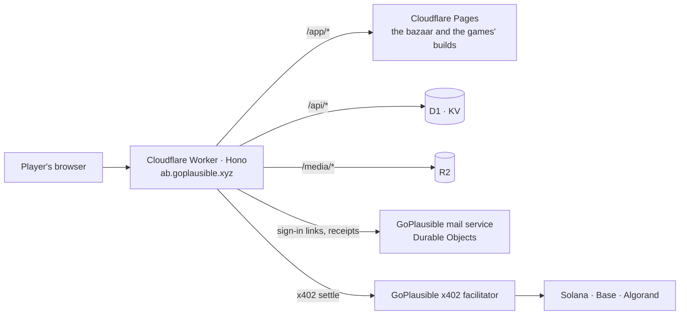

One Worker owns the hostname: it answers the API itself (accounts, coins, runs and boards in D1, sessions in
KV), proxies the app to Cloudflare Pages, and serves large media from R2. The UI and the API are
same-origin, so there is no CORS anywhere.

---

## Tech stack

**TypeScript** throughout · **React** and **Vite** for the platform · the **HTML canvas** for Vintage views ·
**WebGL2**, **Three.js** and custom **GLSL** shaders for Modern views · **Web Audio** for synthesized and recorded sound · **Cloudflare Workers** with **Hono**,
**Pages**, **D1**, **KV**, **R2** and **Durable Objects** · **x402** with USDC on **Solana**, **Base** and
**Algorand** · **Playwright** driving every game in a real browser · **Ganymede**, our own engine.

## Status

|                  |                                                                                                                                                                                                                                                                                               |
| ---------------- | --------------------------------------------------------------------------------------------------------------------------------------------------------------------------------------------------------------------------------------------------------------------------------------------- |
| **Live**         | The bazaar and its eleven games in both views · email sign-in, with the first coin on the house · the x402 coin slot on Solana, Base and Algorand mainnet · credit across every cabinet · high-score boards · the touch gamepad · installable on phones · River Raid and Seaquest on Ganymede |
| **In the works** | The other games on Ganymede · agents playing through **WebMCP**: Ganymede is gaining an interpreter that turns a game's state and moves into tools an AI agent can use, by the same rules as everyone else |

## Credits

The recreations are independent works inspired by classic games; the originals — their titles, characters,
artwork and trademarks — belong to their owners: Activision (part of Microsoft) for River Raid, Pitfall!,
Enduro, Seaquest and Chopper Command, and Atari for Missile Command. Arcade Bazaar is not affiliated with or
endorsed by them. Arc Ninja, Mobius, Afterglow, Runner Noire and The Journey are original games designed by
@emg110 and built by GoPlausible.

## Licence

MIT — see [LICENSE](LICENSE).
